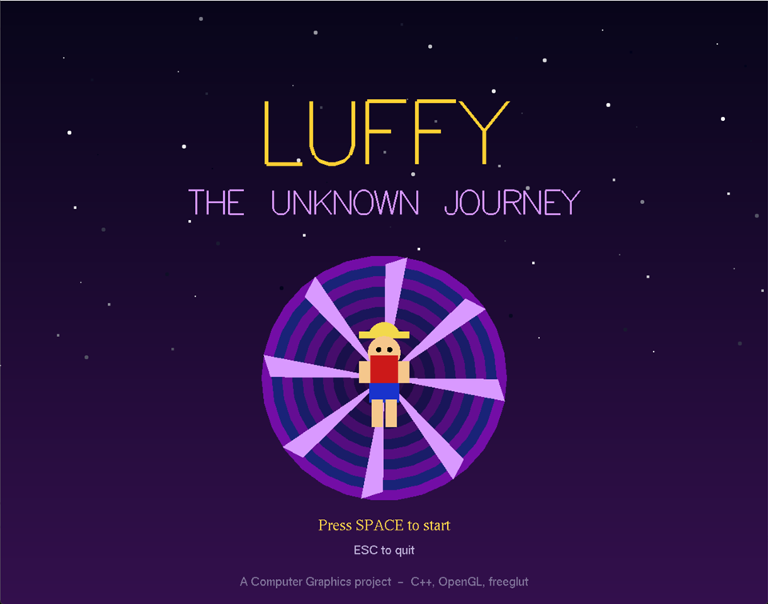
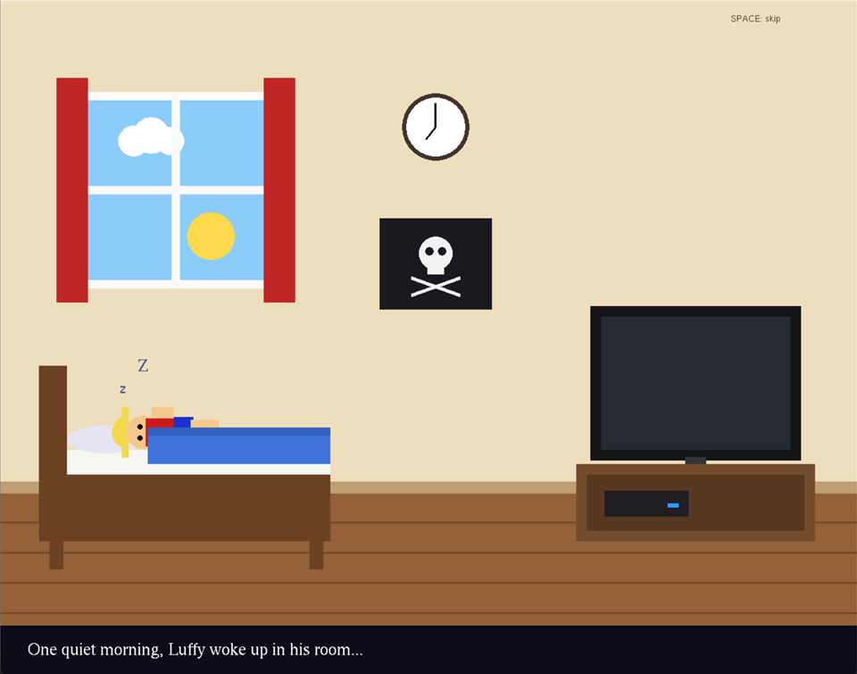
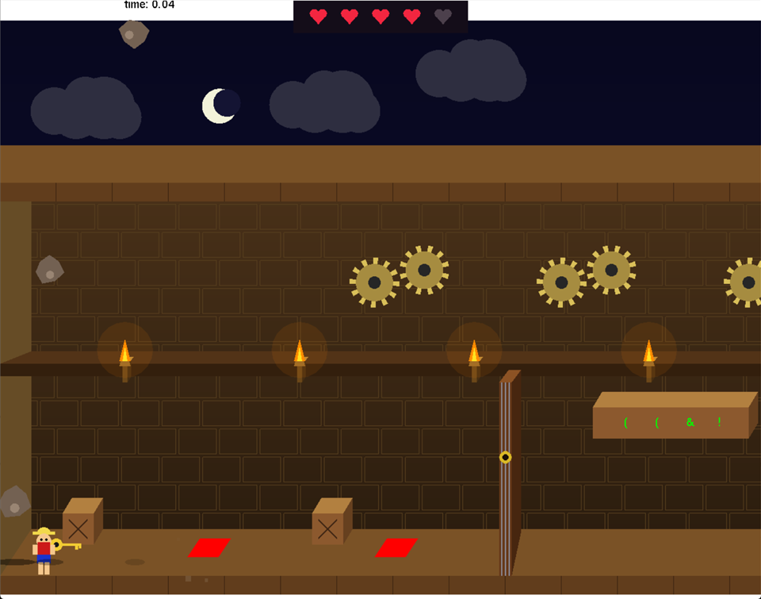
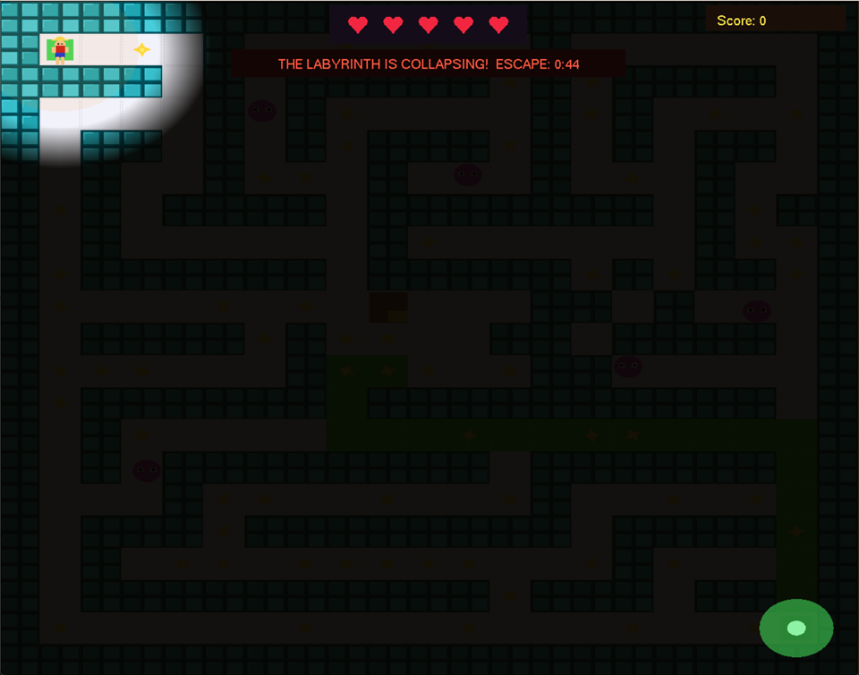
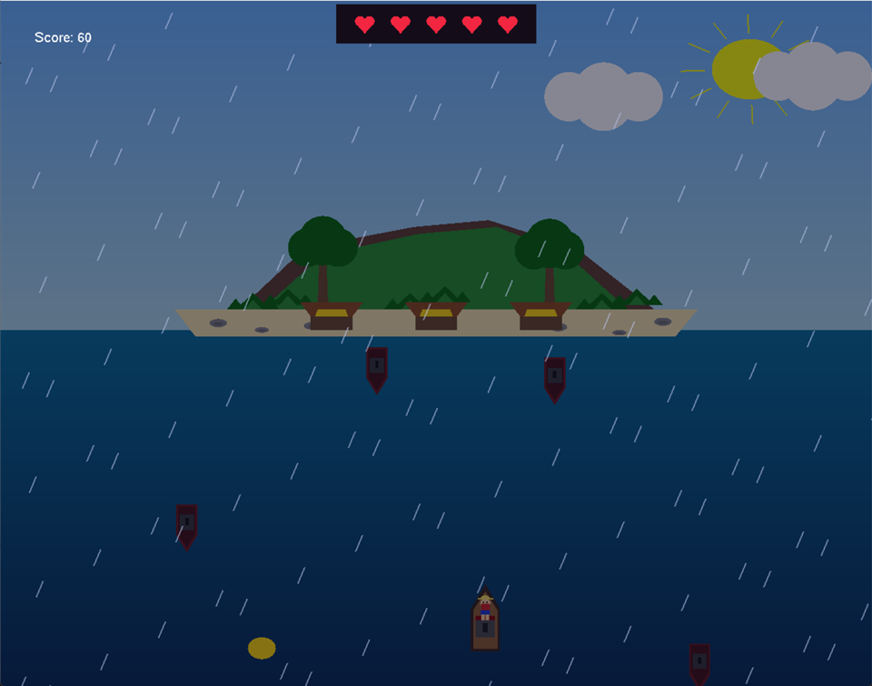
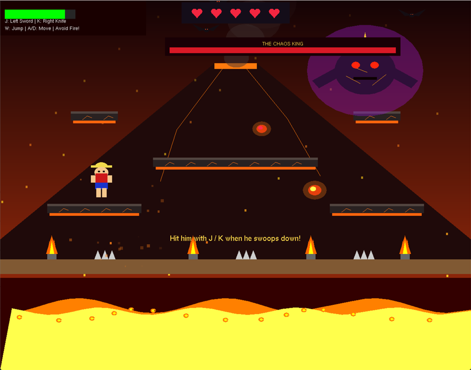

# Luffy: The Unknown Journey

**▶ [Play in your browser](https://durjoysaha21.github.io/Luffy_the_Unknown_Journey-Online/play/)** (no install; Chrome, Edge or Firefox, with a keyboard)

*One morning a boy named Luffy wakes up, sits down at his game console, presses
START, and gets pulled into the World of Chaos. A collapsing fortress, a dark
labyrinth, a sea storm, an island of monsters and a burning volcano stand
between him and home, and on top of the volcano waits the Chaos King.*

A 2D story adventure written in **C++ with OpenGL**, compiled to WebAssembly so
it runs in the browser. Everything on screen is drawn with OpenGL shapes, and
every sound is generated in code.

| Morning in the bedroom | The earthquake |
|---|---|
|  |  |
| **The dark labyrinth** | **The sea storm** |
|  |  |
| **The Chaos King** | |
|  | |

## Controls

Click the game, then **Space** to start. **M** sound on/off · **R** try again after Game Over.

| Level | Keys |
|---|---|
| Dungeon | **W/A/S/D** move · **Space** jump · **E** crates and levers · number keys + **Enter** for the code · **H** launch pad |
| Labyrinth | **Arrow keys** · **B** open the treasure box |
| Sea | **Arrow keys** |
| River | **A/D** move · **W** jump (land on monsters to defeat them) |
| Volcano | hold **A/D** run · **W** jump · **J** sword · **K** knife |

## About

A Computer Graphics course project (8th semester). Level 1, the story and the
story mode by **Durjoy Saha**; levels 2–5 by Rifat, Fahim, Soriya and Keya.

This repository contains only the playable build. The source code is private.

> Fan project: the hero is a tribute to Luffy from *One Piece* (Eiichiro Oda).
> Not affiliated with or endorsed by the creators of One Piece.

© 2026 Durjoy Saha and team. All rights reserved. See [LICENSE](LICENSE).
